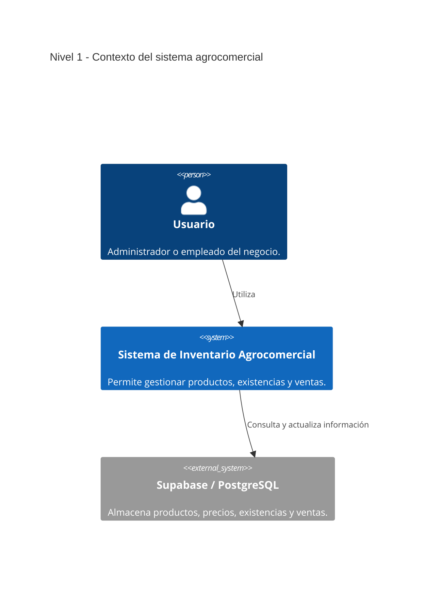
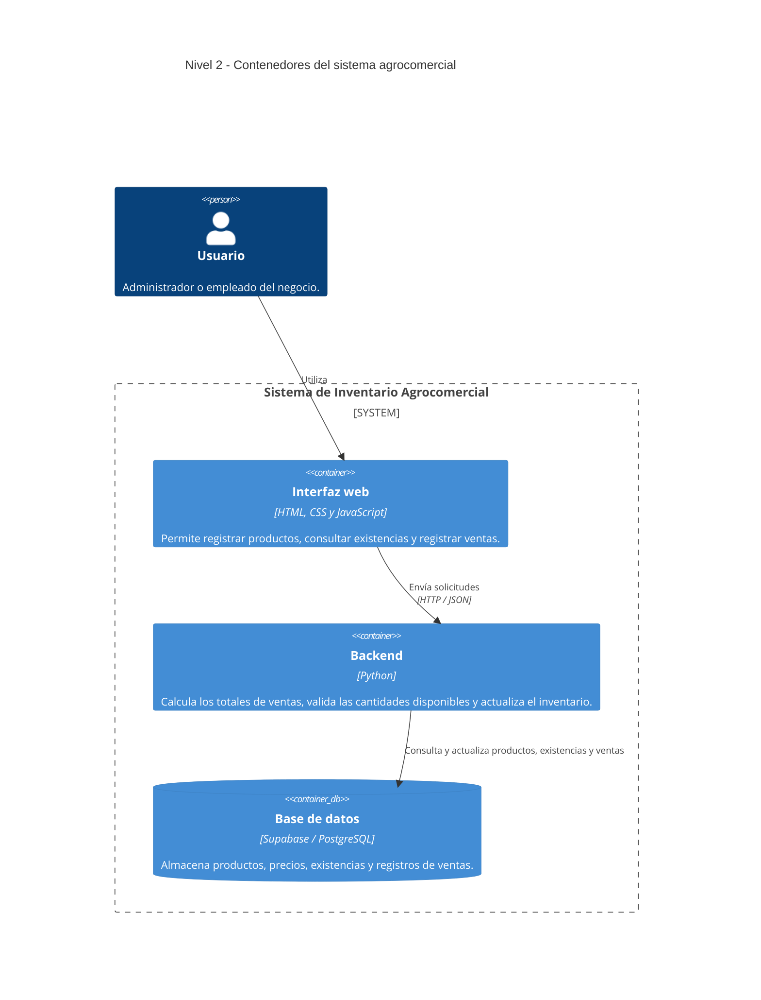

# Arquitectura del Sistema de Inventario Agrocomercial

## 1. Diagrama C4 - Nivel 1: Contexto

### Contexto del sistema

El sistema de inventario agrocomercial permitirá al administrador o empleado registrar productos, consultar las existencias y registrar ventas. El sistema calcula los totales de las ventas y actualiza automáticamente las cantidades disponibles en el inventario.

## 2. Diagrama C4 - Nivel 2: Contenedores

El sistema se organiza en una interfaz web, un backend y una base de datos. Cada componente tiene responsabilidades específicas.

## 3. Justificación de decisiones arquitectónicas

### Decisión 1: Separación entre frontend y backend

Se decidió separar la interfaz web, desarrollada con HTML, CSS y JavaScript, del backend desarrollado en Python.

- **Mantenibilidad:** permite modificar la interfaz sin alterar las reglas de negocio.
- **Modificabilidad:** facilita agregar nuevas funcionalidades al sistema.
- **Testeabilidad:** permite probar la lógica de ventas independientemente de la interfaz.

Se prioriza la mantenibilidad sobre la simplicidad de tener todo el código en un solo lugar, porque el sistema puede crecer con nuevas funcionalidades.

### Decisión 2: Utilización de Supabase con PostgreSQL

Se decidió utilizar Supabase como servicio de base de datos PostgreSQL para almacenar los productos, sus precios, las existencias y las ventas.

- **Integridad:** permite mantener relaciones entre productos y ventas.
- **Confiabilidad:** permite almacenar y consultar información estructurada.
- **Consistencia:** es importante que las cantidades disponibles se actualicen correctamente después de cada venta.

Se prioriza la integridad de los datos sobre la utilización de un almacenamiento más sencillo, porque un error en las existencias puede afectar directamente las ventas del negocio.

## 4. Correcciones realizadas al borrador generado con IA

Se revisó el borrador inicial y se realizaron las siguientes correcciones:

1. Se sustituyeron tecnologías genéricas por las tecnologías reales del proyecto: HTML, CSS, JavaScript, Python y Supabase con PostgreSQL.
2. Se eliminaron contenedores y servicios que no forman parte del sistema agrocomercial.
3. Se identificaron correctamente las responsabilidades del frontend y del backend.
4. Se agregó el proceso de actualización automática de existencias después de registrar una venta.
5. Se ajustaron las relaciones entre los usuarios, la interfaz, el backend y la base de datos.

La revisión permitió obtener una arquitectura más cercana al funcionamiento real del sistema y evitar representar funcionalidades que todavía no están implementadas.

